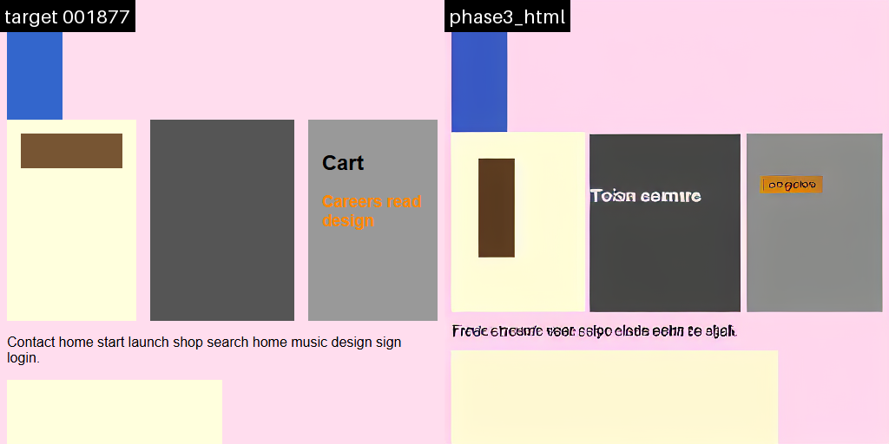
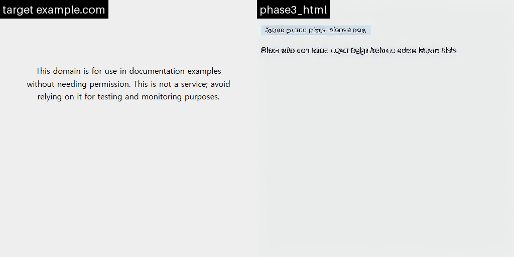

# stable-diffusion-web-engine

| 학습 데이터와 같은 형식의 HTML (검증셋, 학습에 쓰지 않음)                  | 실제 웹페이지 `example.com` (학습 분포 밖)                                                  |
| -------------------------------------------------------------------------- | ------------------------------------------------------------------------------------------- |
|  |  |

각 그림의 왼쪽은 HTML을 실제 브라우저(Chromium)로 렌더링한 정답이고, 오른쪽은 이 프로젝트의 모델(v3)이 **같은 HTML만 보고 그린 이미지**입니다.

## 한눈에 보기

HTML 코드를 넣으면, 그 HTML을 브라우저로 열었을 때의 화면처럼 보이는 **이미지를 생성하는** Stable Diffusion 모델을 만든 취미/학습 프로젝트입니다.

- 브라우저처럼 HTML을 해석해서 그리는 프로그램이 아닙니다. HTML과 스크린샷 쌍을 수만 개 보여 주며 학습시킨 **이미지 생성 모델**이 "이 HTML이면 화면이 대충 이렇게 생겼겠지"를 그려 냅니다.
- 목표는 정확한 렌더링이 아니라(그건 브라우저가 합니다), **단순한 HTML을 넣었을 때 배경색, 블록 위치, 대략적인 요소 배치가 원본과 눈에 띄게 닮은 이미지**를 만드는 것입니다.
- 결과: 학습 데이터와 비슷한 HTML은 배경색과 박스, 칼럼, 버튼 배치를 꽤 정확히 재현합니다. 다만 **글자는 알아볼 수 없고**, 학습 때 보지 못한 방식으로 짠 실제 웹페이지의 경우 정확도가 낮습니다.

| 항목          | 내용                                                                                           |
| ------------- | ---------------------------------------------------------------------------------------------- |
| 베이스 모델   | Stable Diffusion 1.5 (처음부터 학습하지 않고 이어서 학습)                                      |
| 학습 데이터   | 프로그램으로 무작위 생성한 HTML과, 이를 브라우저로 찍은 512×512 스크린샷 쌍 (최대 3만 쌍)      |
| 최종 모델(v3) | HTML을 코드용 언어 모델(CodeT5+)로 읽어 이미지 생성에 반영. 입력은 최대 512토큰(약 1.5KB HTML) |
| 학습 환경     | 데이터 생성과 평가는 개인 PC(GTX 1660 SUPER 6GB), 본 학습은 클라우드 GPU(A100)                 |

## 왜 이딴걸 만들었나요?

X(구 트위터)를 보는데 [재미있는 트윗](https://x.com/shiftpsh/status/2111436630871724539)을 발견했고 전 참을 수 없었습니다.

## 본격적인 프로젝트 설명에 앞서...

이 프로젝트는 제가 사실상 처음으로 Claude Code에 전적으로 의존해서 만든 프로젝트이고, 다음 단계(Phase)를 차례로 거쳐 진행했습니다.

| 단계    | 한 일                                                                      |
| ------- | -------------------------------------------------------------------------- |
| Phase 0 | 개발 환경 구성                                                             |
| Phase 1 | 학습 데이터셋 생성 (HTML 생성기 + 브라우저 스크린샷)                       |
| Phase 2 | 베이스라인 모델 학습: 짧은 HTML로 "이게 되긴 하는지" 확인 (**v1**, **v2**) |
| Phase 3 | 긴 HTML도 입력받을 수 있게 모델 구조 변경 (**v3**)                         |
| Phase 4 | 평가: 고정된 검증셋으로 모델 버전 비교                                     |

README만 읽어서는 잘 이해되지 않는 부분이 있을 수 있어 최대한 줄이려고 했습니다. 그래도 막히는 부분이 있으면 [CLAUDE.md](CLAUDE.md)(계획과 작업 규칙)와 [handoff.md](handoff.md)(각 단계에서 무엇을 어떻게 삽질했는지 자세한 기록)를 참고해 주세요.

## 모델 버전

| 버전   | 만든 단계 | 방식                                                    | 입력 길이   | 결과                                        |
| ------ | --------- | ------------------------------------------------------- | ----------- | ------------------------------------------- |
| v1     | Phase 2   | CLIP 인코더 + **LoRA**                                  | 77토큰      | 실패: 얼룩진 질감, 레이아웃 불일치          |
| v2     | Phase 2   | CLIP 인코더 + UNet **full fine-tuning**                 | 77토큰      | 짧은 HTML에서 성공. 긴 HTML은 앞부분만 반영 |
| **v3** | Phase 3   | **CodeT5+ 인코더** + projection + UNet full fine-tuning | **512토큰** | 긴 HTML까지 페이지 전체 구조를 재현         |

## 결과 요약

학습에 쓰지 않은 고정 검증셋(세트마다 HTML 50개)에서 버전별로 이미지를 생성해, 정답 렌더링과 얼마나 비슷한지 쟀습니다.

**긴 HTML** (제한 없는 생성기로 만든 HTML, CodeT5+ 기준 512토큰 이하)

| 모델                                        | MSE ↓      | SSIM ↑     | LPIPS ↓    | CLIP ↑     | OCR ↑      |
| ------------------------------------------- | ---------- | ---------- | ---------- | ---------- | ---------- |
| v1: LoRA (CLIP)                             | 0.1266     | 0.4909     | 0.8153     | 0.5638     | 0.1628     |
| v2: UNet full FT (CLIP)                     | 0.0318     | 0.8996     | 0.2384     | 0.7199     | 0.1891     |
| **v3: CodeT5+ + projection + UNet full FT** | **0.0189** | **0.9096** | **0.1634** | **0.7309** | **0.1916** |

**짧은 HTML** (CLIP 77토큰 이하로 제한해 만든 HTML)

| 모델                                        | MSE ↓      | SSIM ↑     | LPIPS ↓    | CLIP ↑     | OCR ↑      |
| ------------------------------------------- | ---------- | ---------- | ---------- | ---------- | ---------- |
| v1: LoRA (CLIP)                             | 0.0945     | 0.4658     | 0.8261     | 0.6308     | 0.1495     |
| v2: UNet full FT (CLIP)                     | 0.0041     | 0.9681     | 0.0466     | **0.8528** | **0.2305** |
| **v3: CodeT5+ + projection + UNet full FT** | **0.0030** | **0.9810** | **0.0285** | 0.8276     | 0.1466     |

지표 읽는 법 (↓는 낮을수록, ↑는 높을수록 좋음):

| 지표  | 뜻                                                                                                                         |
| ----- | -------------------------------------------------------------------------------------------------------------------------- |
| MSE   | 픽셀 색 차이의 평균. 0이면 완전히 같습니다. 큰 블록 위치가 조금만 어긋나도 크게 나빠집니다.                                |
| SSIM  | 밝기, 대비, 구조가 얼마나 비슷한지 (최대 1)                                                                                |
| LPIPS | 신경망이 판단한 "사람 눈에 비슷해 보이는 정도"의 거리                                                                      |
| CLIP  | 생성 이미지와 정답 이미지를 CLIP으로 요약한 벡터의 유사도 (전체적인 인상)                                                  |
| OCR   | 정답 이미지에서 읽힌 글자와 생성 이미지에서 읽힌 글자의 일치율. OCR 자체가 작은 글자를 잘 못 읽어서 대략적인 참고용입니다. |

정리하면:

- **v3가 레이아웃(배경색, 박스와 칼럼 위치, 버튼)을 가장 잘 재현합니다.** 긴 HTML에서 v2는 77토큰에서 입력이 잘려 첫 요소 정도만 그리지만, v3는 페이지 전체 구조를 그립니다.
- **글자는 모든 버전에서 알아보기 어렵습니다.** 짧은 HTML의 글자 관련 지표(OCR, CLIP)는 v2가 약간 낫습니다.
- **v1(LoRA)은 실패했습니다.** UNet 전체를 학습(v2)하고 나서야 레이아웃이 맞기 시작했습니다.

## 동작 방식

```
HTML → CodeT5+ 토크나이저 (최대 512토큰)
     → CodeT5+ 인코더 (고정, 학습 안 함) → projection (작은 변환층, 학습)
     → UNet에 조건으로 전달 (cross-attention)
노이즈 → UNet이 25단계에 걸쳐 노이즈 제거 → VAE 디코더 → 512×512 이미지
```

- 원래 T5/FLAN-T5 어휘에는 <가 없어서 HTML 태그가 깨집니다. CodeT5+는 HTML을 손실 없이 토큰화하고, 은닉 차원(768)이 SD 1.5 cross-attention과 같습니다.
- 학습 설정: v-prediction + zero terminal SNR(마지막 timestep에 원본 신호가 남지 않도록 노이즈 스케줄 재조정). 단색 배경이 많은 데이터에서 SD 1.5 기본 스케줄은 전역 색과 레이아웃을 잘 배우지 못했습니다.
- v3의 UNet은 v2의 UNet에서 출발해 이어서 학습했습니다.
- v3의 UNet은 v2 체크포인트(CLIP 조건으로 HTML 렌더링을 이미 배운 UNet)에서 시작하고, 처음 500 step은 UNet을 고정한 채 projection만 학습합니다.

## 요구 사항

- Python 3.11 이상 (검증 환경: Windows 11, Python 3.14.7)
- NVIDIA GPU
    - 로컬: 데이터 생성, 추론, 평가는 6GB(GTX 1660 SUPER)에서 확인했습니다. 추론에 약 5GB를 씁니다.
    - 학습: UNet full fine-tuning은 24GB 이상이 필요해 클라우드 GPU(Vast.ai A100 40GB에서 확인)를 사용합니다.
- 디스크: 데이터, 캐시, 체크포인트로 수십 GB

## 설치 (Windows, PowerShell)

```powershell
py -3.14 -m venv .venv
.venv\Scripts\Activate.ps1

# 1) torch: GPU/드라이버에 맞는 빌드를 설치합니다 (requirements-torch.txt 주석 참고)
#    드라이버가 CUDA 13을 지원하는 NVIDIA GPU 예시
pip install -r requirements-torch.txt --index-url https://download.pytorch.org/whl/cu130

# 2) 나머지 패키지
pip install -r requirements.txt

# 3) 렌더링용 브라우저
playwright install chromium

# 4) 환경 점검: [FAIL]이 없어야 합니다 (GPU가 없거나 VRAM이 작으면 [WARN])
python scripts/check_env.py
```

SD 1.5(`stable-diffusion-v1-5/stable-diffusion-v1-5`)와 CodeT5+(`Salesforce/codet5p-220m`) 가중치는 처음 실행할 때 Hugging Face에서 자동으로 내려받습니다.

## 바로 써 보기 (추론)

체크포인트 폴더를 받아 두었다면 HTML 한 줄로 이미지를 만들 수 있습니다.

학습된 체크포인트는 아래 "전체 파이프라인"으로 직접 학습하거나, [Release 탭](https://github.com/bass9030/stable-diffusion-web-engine/releases)에서 받을 수 있습니다.

```powershell
# v3 모델 (체크포인트의 config.yaml을 보고 CodeT5+ 인코더와 projection을 자동으로 사용)
python -m src.infer.generate --full <PATH_TO_V3_CHECKPOINT> `
    --html-text '<body style="margin:0;padding:16px;background:#def"><h1>Hello world</h1><div style="width:50%;height:120px;background:#e33"></div></body>' `
    --out outputs/infer/hello.png

# HTML 파일 입력, 시드/스텝/guidance 지정
python -m src.infer.generate --full <PATH_TO_V3_CHECKPOINT> --html page.html --out out.png --seed 42 --steps 25 --guidance 3.0

# v2 (CLIP) full FT 체크포인트도 --full
python -m src.infer.generate --full <PATH_TO_V2_CHECKPOINT> --html page.html --out out.png

# v1 LoRA 체크포인트
python -m src.infer.generate --lora <PATH_TO_V1_LORA> --html page.html --out out.png
```

좋은 결과를 얻으려면:

- 학습 데이터처럼 **인라인 스타일**(`style="..."`)로 div, 제목, 문단, 버튼, flex 칼럼을 쓴 HTML이 가장 잘 됩니다.
- 입력이 인코더 최대 길이(v3: 512토큰 ≈ 1.5KB, v1/v2: 77토큰)를 넘으면 경고를 남기고 뒷부분을 자릅니다.
- 같은 HTML이라도 `--seed`를 바꾸면 결과가 조금씩 달라집니다.

## 전체 파이프라인 (직접 학습하기)

### 1. 학습 데이터셋 생성

```powershell
# 1만 쌍 (제한 없는 생성기) → data/
python -m src.datagen.build_dataset
# 짧은 HTML 5천 쌍 (CLIP 77토큰 이하만) → data/short   (v1, v2용)
python -m src.datagen.build_dataset --config configs/base.yaml configs/datagen.yaml configs/datagen_short.yaml
# 긴 HTML 3만 쌍 (CodeT5+ 512토큰 이하만) → data/long   (v3용)
python -m src.datagen.build_dataset --config configs/base.yaml configs/datagen.yaml configs/datagen_long.yaml

# 재현성 확인: 일부 샘플을 새 브라우저로 다시 만들어 HTML/PNG 해시 비교
python scripts/check_datagen_repro.py --data-dir data/long --num 100
```

- 출력: `{id}.html`, `{id}.png`, `metadata.jsonl`(시드, 학습/검증 분할, 토큰 수, 해시), `render_env.json`(브라우저 버전, 화면 크기, 글꼴, 생성 설정), `summary.json`. 렌더링에 실패한 샘플은 `failures.jsonl`에 남깁니다.
- 학습/검증 분할은 샘플 시드로 정해지고, 검증셋은 학습에 쓰지 않습니다.

### 2. v1, v2 학습 (짧은 HTML, CLIP 인코더)

```powershell
# 학습 속도를 위해 VAE latent와 CLIP 임베딩을 미리 계산 → outputs/cache/short
python -m src.train.cache_features --config configs/base.yaml configs/train_lora.yaml

# v1: LoRA (로컬 GPU에서 가능. 성공 기준에는 미달)
python -m src.train.train_lora --config configs/base.yaml configs/train_lora.yaml configs/train_lora_v8.yaml

# v2: UNet full fine-tuning (클라우드 GPU). 24GB GPU는 뒤에 configs/train_full_24gb.yaml을 붙입니다
python -m src.train.train_full --config configs/base.yaml configs/train_lora.yaml configs/train_full.yaml
```

### 3. v3 학습 (긴 HTML, CodeT5+ 인코더)

```powershell
# latent와 CodeT5+ 인코더 출력을 미리 계산 → outputs/cache/long
python -m src.train.cache_html --config configs/base.yaml configs/train_lora.yaml configs/train_full.yaml configs/train_html.yaml

# 학습 (configs/train_html.yaml의 model.unet_init에 지정한 v2 체크포인트에서 시작)
# 24GB GPU는 뒤에 configs/train_full_24gb.yaml을 붙입니다
python -m src.train.train_html --config configs/base.yaml configs/train_lora.yaml configs/train_full.yaml configs/train_html.yaml
```

모든 학습 스크립트의 공통 동작:

- 본 학습 전에 32장으로 overfit 테스트를 해 파이프라인을 확인합니다(`configs/*_overfit.yaml`을 뒤에 붙임).
- 일정 step마다 고정 샘플로 `samples/step_XXXXXX.png`(행마다 정답 | 생성)와 `samples/metrics.jsonl`을 저장해 학습 경과를 눈으로 확인할 수 있습니다.
- 체크포인트에는 사용한 설정(`config.yaml`)과 git commit(`run_info.json`)을 함께 저장합니다.
- `train_full`, `train_html`은 `--resume <checkpoints/step_XXXXXX>`로 이어서 학습할 수 있습니다(옵티마이저 상태는 새로 시작).

### 4. 클라우드 GPU에서 학습하기 (Vast.ai / RunPod / Colab)

로컬에서 코드와 데이터를 zip 하나로 묶어 올리고, 노트북으로 설치부터 학습, 결과 묶기까지 실행합니다.

```powershell
# v1/v2용: 코드 + outputs/cache/short
python scripts/pack_for_colab.py
# v3용: 코드 + 원본 데이터 + 시작점 UNet(v2 체크포인트). 캐시는 클라우드에서 생성
python scripts/pack_for_colab.py --no-cache --data-dir data/long --extra outputs/full_short_rental/checkpoints/step_006000
```

- **Vast.ai / RunPod 등 일반 Jupyter**: `outputs/colab_bundle.zip`과 [notebooks/rental_train.ipynb](notebooks/rental_train.ipynb)를 인스턴스의 `/workspace/`에 올리고, `MODE`를 `"lora"`(v1), `"full"`(v2), `"html"`(v3) 중 하나로 정해 차례로 실행합니다. 결과는 `/workspace/results_<run>.zip`으로 묶입니다. 인스턴스를 삭제하면 디스크도 지워지니, 그 전에 내려받으세요.
- **Colab**: [notebooks/colab_full_finetune.ipynb](notebooks/colab_full_finetune.ipynb) (v2 학습. Google Drive에 zip을 올리고 출력도 Drive에 저장).
- GPU에 맞는 설정은 노트북이 자동으로 고릅니다. 80GB는 기본(배치 8, bf16), 24~40GB는 `train_full_24gb.yaml`(배치 4×2, 8-bit Adam), bf16을 지원하지 않는 T4는 `train_full_t4.yaml`입니다.
- 참고: A100 40GB에서 v2(6000 step)는 약 1시간, v3(10000 step)는 약 1시간 40분 걸렸습니다.

### 5. 평가

```powershell
# 모델별 평가 이미지 생성 (이미 있으면 건너뜀) → outputs/eval/{model}/{set}/{id}.png
python -m src.eval.generate_eval --config configs/base.yaml configs/eval.yaml
# 지표 계산, 비교표와 비교 그리드 → outputs/eval/report.md, metrics.csv, summary.json, grid_{set}.png
python -m src.eval.report --config configs/base.yaml configs/eval.yaml
# 그리드만 다시 만들기
python -m src.eval.report --config configs/base.yaml configs/eval.yaml --grids-only
```

비교할 모델과 검증셋 크기는 [configs/eval.yaml](configs/eval.yaml)에서 정합니다.

## 설정 파일

`--config`에 yaml 파일 여러 개를 순서대로 넘기면 합쳐지고, 뒤 파일의 값이 앞 파일을 덮어씁니다. 하이퍼파라미터는 코드에 직접 쓰지 않고 모두 여기에 둡니다.

| 파일                                                                                       | 내용                                            |
| ------------------------------------------------------------------------------------------ | ----------------------------------------------- |
| `base.yaml`                                                                                | 공통: 시드, 경로, 렌더링(512×512, Arial)        |
| `datagen.yaml`, `datagen_short.yaml`, `datagen_long.yaml`                                  | 데이터 생성기와 토큰 수 필터                    |
| `train_lora.yaml`                                                                          | 모델, 데이터, 캐시, LoRA, 학습, 샘플링의 기본값 |
| `train_lora_v8.yaml`, `train_lora_rental.yaml`, `train_lora_overfit*.yaml`                 | v1(LoRA) 실험 설정                              |
| `train_full.yaml`, `train_full_24gb.yaml`, `train_full_t4.yaml`, `train_full_overfit.yaml` | v2(UNet full fine-tuning)와 GPU별 설정          |
| `train_html.yaml`, `train_html_overfit.yaml`                                               | v3(CodeT5+ 인코더, projection, 시작점 UNet)     |
| `eval.yaml`                                                                                | 평가                                            |

## 디렉터리 구조

```
stable-diffusion-web-engine/
├── configs/          # 설정 (yaml)
├── scripts/          # check_env.py(환경 점검), check_datagen_repro.py(재현성), pack_for_colab.py(클라우드용 zip)
├── src/
│   ├── datagen/      # HTML 생성기, Playwright 렌더러, 데이터셋 빌드
│   ├── models/       # CodeT5+ 토크나이저/인코더, projection
│   ├── train/        # 캐시 생성, v1(LoRA) / v2(full FT) / v3 학습
│   ├── infer/        # 샘플링 루프, 추론 스크립트
│   └── eval/         # 평가 이미지 생성, 지표, 리포트
├── notebooks/        # 클라우드 학습 노트북 (Colab, 대여 GPU)
├── docs/             # README 이미지
├── data/             # 생성 데이터 (git 제외)
└── outputs/          # 캐시, 체크포인트, 샘플, 평가 결과 (git 제외)
```

## 재현성

- 모든 스크립트는 시드를 인자로 받고, 기본값은 설정 파일에 고정돼 있습니다.
- 데이터 생성은 시드로 결정됩니다. 같은 시드와 같은 렌더링 환경(브라우저 버전 등, `render_env.json`에 기록)이면 HTML과 PNG가 바이트 단위로 같습니다.
- 학습 출력과 체크포인트에는 설정과 git commit이 기록됩니다. 클라우드용 zip에는 `.git`이 없어 `run_info.json`의 commit이 비고, 대신 zip 안의 `BUNDLE_INFO.json`에 기록됩니다.

## 한계와 알려진 이슈

- **글자**: 대략적인 모양만 나오고 읽을 수 있는 수준은 아닙니다. 이미지를 8배 압축한 상태에서 그리기 때문입니다.
- **학습하지 않은 HTML**: 생성기가 만드는 요소(div, 제목, 문단, 버튼, 칼럼, 인라인 스타일)만 학습했습니다. `<style>` 블록, 가운데 정렬(`margin: auto`), `<table>`, ``, 외부 CSS 등은 제대로 그리지 못합니다. 위의 `example.com` 예시(2026-10-20에 받은 577바이트 HTML)는 배경색은 맞지만, 가운데 정렬된 문단을 왼쪽 위에 그렸습니다.
- **입력 길이**: v3는 최대 512토큰(이 프로젝트 스타일의 HTML 기준 약 1.4~1.7KB)입니다. 출력도 512×512 고정이라 화면 밖으로 넘치는 내용은 그리지 않습니다.
- **CodeT5+ 토크나이저**: transformers 5.20에서 저장소의 토크나이저 설정을 불러오지 못해, `tokenizers`로 vocab/merges를 직접 읽습니다(`src/models/html_encoder.py`).

## Special Thanks

- X(구 트위터) 시프트([@shiftpsh](https://x.com/shiftpsh))님: [아이디어 제공](https://x.com/shiftpsh/status/2111436630871724539)

## 참고

- Hugging Face `diffusers` 문서와 text-to-image 학습 예제
- Lin et al., "Common Diffusion Noise Schedules and Sample Steps are Flawed" (2023): zero terminal SNR, v-prediction
- CodeT5+ (`Salesforce/codet5p-220m`)
- WebSight, Design2Code (HTML-스크린샷 쌍 데이터, 주로 스크린샷→HTML 방향)
- ControlNet, GLIGEN (레이아웃 조건 입력, 이 프로젝트에서는 미사용)
